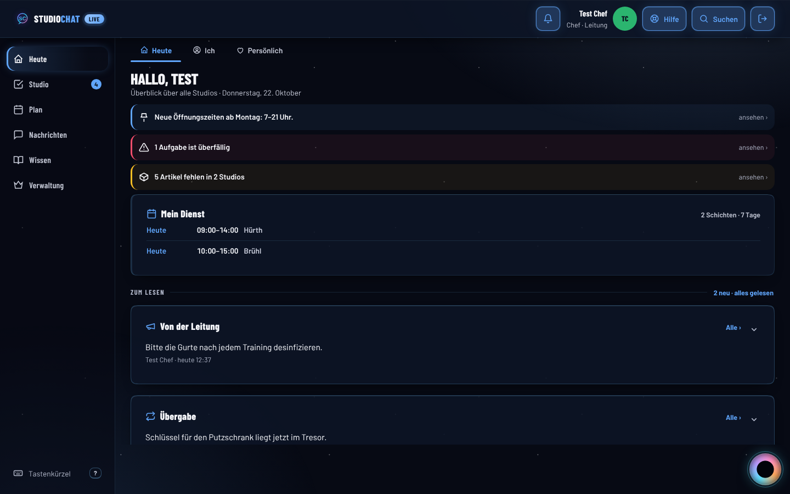
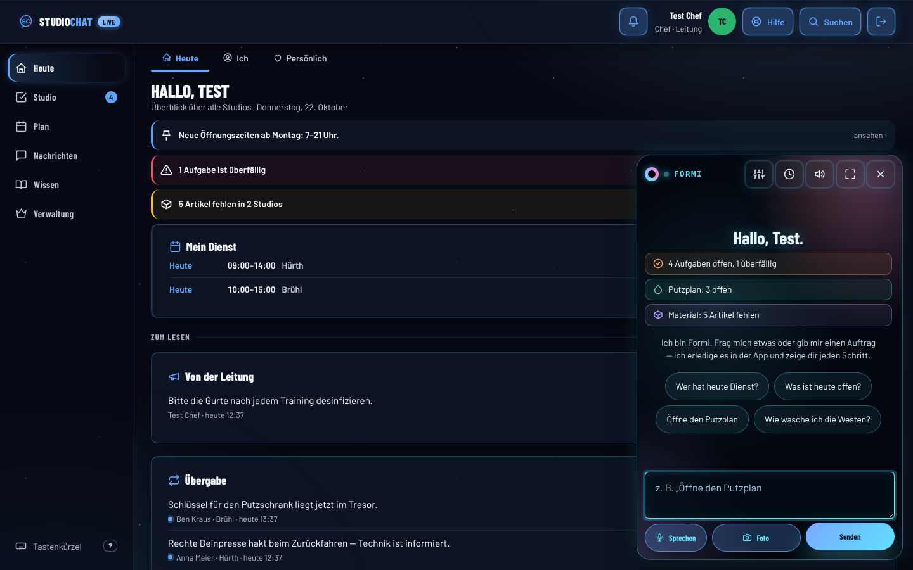
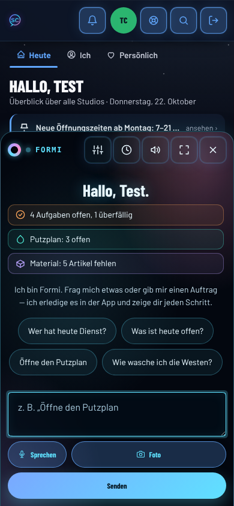

# Formi im Design — Ideen

**Auftrag aus dem Betrieb (22.10.2026):** „reine ideen wie wir formi mehr ins
design integrieren können“.

Das hier ist ein **Ideenpapier**: Es gibt keinen Code und nichts ist gebaut.
Aufwand und Wirkung sind **geschätzt**, nicht gemessen. Die Studien sind
aus dem Gedächtnis zitiert und wurden für dieses Papier **nicht neu
abgerufen** (Abschnitt „Quellen“). Wer eine Idee baut, prüft die Quelle
vorher nach.

Gelesen vorher: `CLAUDE.md`, `docs/design-vorbilder/ki-assistent.md`,
`docs/design-vorbilder/farbe-tiefe-bewegung.md`, `FORTSCHRITT.md`
Runden 177–184.

---

## 1. Ist-Stand (angesehen am 22.10.2026, Attrappe `stub-chef.js`)

| Rechner 1440 × 900, Startseite | Rechner, Formi offen | Handy 390 × 844, Formi offen |
|---|---|---|
|  |  |  |

**Was man sieht:**
- **Die Kugel** ist 58 × 58 px gross (gemessen per `getBoundingClientRect`).
  Am Rechner sitzt sie bei x 1366 / y 826, am Handy bei x 316 / y 706,
  über der Leiste.
  Ausserhalb von ihr kommt Formi auf der Startseite **nicht vor**.
- **Der Raum** (Stil „Formi“) trägt die ganze App. Deshalb hebt sich Formi
  selbst kaum noch ab: Fenster, Karten und Formi-Fenster haben dasselbe
  dunkle Glas. Das ist der Preis von Runde 178. Die App sieht jetzt aus
  wie Formis Welt, und Formi ist darin keine eigene Figur mehr.
- **Doppelt:** Die Startseite meldet „1 Aufgabe ist überfällig“ und
  „5 Artikel fehlen in 2 Studios“. Öffnet man Formi, steht dasselbe noch
  einmal da („4 Aufgaben offen, 1 überfällig“, „Material: 5 Artikel
  fehlen“), dazu ein zweites „Hallo, Test“.
- **Kopf des Formi-Fensters:** fünf Symbolknöpfe (Einstellungen, Verlauf,
  Ton, Groß, Schliessen), dazu „Sprechen“, „Foto“, „Senden“ und vier
  Vorschläge. Das sind zwölf Bedienelemente in einem Fenster von
  420 px Breite.
- Was Formi **getan** hat (z. B. eine Aufgabe angelegt), sieht man in der
  App danach nicht mehr. Nur im Verlauf steht es.

**Die Spannung:** Formi soll mehr ins Design. Das Hauptproblem der App ist
aber „zu viel“ (Runde 184). Daraus folgt die Regel für dieses Papier:

> **Formi kommt dazu, wo es etwas ersetzt oder zusammenfasst. Wo es nur
> zusätzlich auftaucht, kommt es nicht dazu.**

Jede Idee unten hat deshalb die Zeile **„Bilanz“**. Sie sagt, wie viele
Elemente die Idee auf dem Bildschirm dazubringt oder wegnimmt.

---

## 2. Was die Vorbilder machen (kurz)

| Vorbild | Muster | Was wir daraus lernen |
|---|---|---|
| **Microsoft 365 Copilot** | Eigenes Zeichen mit Farbverlauf. Taucht im Dokument genau dort auf, wo man arbeitet (am Rand neben dem Absatz), und fasst in Teams zusammen, was man verpasst hat | Formi kommt an die Stelle der Arbeit. Ein festes Zeichen bedeutet immer „KI“ |
| **Notion AI** | Ein kleines Gesicht; es wird mit der Leertaste in einer leeren Zeile oder mit „/“ gerufen. Ergebnisse stehen bis „Übernehmen“ als Vorschlag da | Formi im **leeren** Platz. Ein Vorschlag sieht anders aus als Fertiges |
| **Duolingo (Duo)** | Das Maskottchen hat wenige, klare Ausdrücke. Es feiert Serien und tritt in Benachrichtigungen auf | Persönlichkeit durch **wenige Zustände**, nicht durch ständige Präsenz |
| **Apple Intelligence / Siri (iOS 18)** | Bei Siri leuchtet einmal der Bildschirmrand in einem bunten Verlauf. Schreibwerkzeuge erscheinen an der Markierung | Ein **Lichtsignal statt einer Figur**: „jetzt handelt die KI“ |
| **Linear** | KI-Vorschläge in der Triage (Zuständige, Labels) stehen eingebettet und gedämpft in der Zeile, mit Begründung | Vorschläge leben **in** der Liste, nicht in einem Chat daneben |
| **Clippy (Office 97–2003)** | Sprang ungefragt mit Sprechblasen ins Bild | Das Gegenbeispiel. Genau das darf Formi nie werden |

Die Vorbilder im Ordner `design-vorbilder/ki-assistent.md` (Intercom,
Copilot in Edge, Gemini, Claude in Chrome, HIG, HAX) gelten weiter. Sie
werden hier nicht wiederholt, nur aufgegriffen.

---

## 3. Die Ideen

Aufwand: **S** = etwa eine Runde, **M** = zwei bis drei Runden, **L** = ein
eigener Bereich. Alles geschätzt.

### Idee 1 — Eine Formi-Zeile statt drei Hinweisbändern ⭐

**Was man sieht:** Oben auf „Heute“ steht statt drei Bändern (Ankündigung,
überfällig, Material) **eine** Zeile. Links sitzt der Formi-Ring (klein,
24 px), daneben in einem Satz: „1 Aufgabe überfällig · 5 Artikel fehlen ·
neue Öffnungszeiten“. Jeder Teil ist tippbar. Die Statusfarbe bleibt als
Punkt vor dem jeweiligen Teil (rot, bernstein). Ein Tipp auf den Ring
öffnet Formi mit genau diesem Stand.

**Wo:** Startseite „Heute“, Rechner und Handy.

**Warum:** Diese Meldungen schreibt sowieso Formi im Fenster (siehe
Ist-Stand), nur steht sie heute doppelt da. Wenn sie Formi zugeordnet
wird, bekommt Formi einen festen Platz auf der meistgesehenen Seite,
und es kommt nichts dazu. Unruhe auf dem Bildschirm bestimmt den ersten
Eindruck stärker als Farbe (Reinecke & Gajos 2013, schon in Runde 184
zitiert). Ruhige Technik gehört an den Rand der Aufmerksamkeit (Weiser &
Brown 1996, „Calm Technology“).

**Bilanz:** −2 Elemente auf der Startseite. Am Handy werden etwa 110 px
frei (geschätzt: zwei Bänder zu je ~54 px). Damit passt „Mein Dienst“
eher noch auf den ersten Bildschirm.

**Aufwand:** S–M. **Risiko:** Ein Satz mit drei Teilen ist schwerer zu
überfliegen als drei Bänder. Ab vier Meldungen kommt „+2“ dazu. Ein
Überfällig-Hinweis darf nicht im Fliesstext verschwinden: Der rote Punkt
bleibt, und der Kontrast wird gemessen.

---

### Idee 2 — Die Kugel zeigt ihren Zustand, ohne zu reden ⭐

**Was man sieht:** Die Kugel hat vier ruhige Zustände und keine
Sprechblase:

| Zustand | Was die Kugel zeigt |
|---|---|
| Ruhe | wie heute |
| Arbeitet | Die Scheibe dreht sich (das gibt es schon im Fenster, nicht an der Kugel) |
| Hat etwas für dich | ein kleiner Punkt in Formi-Farbe am Rand, **nicht rot** |
| Wartet auf „Stopp“ (die 3 s aus Runde 177) | Der Ring füllt sich einmal rundherum; ein Tipp hält an |

**Wo:** `#formiKugel`, überall wo sie steht.

**Warum:** Die Kugel ist schon da. So arbeitet sie mehr, ohne dass etwas
dazukommt. Horvitz (1999) beschreibt für mitdenkende Oberflächen, dass
der Assistent die Kosten einer Unterbrechung abwägen und im Zweifel
**leise** anbieten soll. Unterbrechungen erhöhen nachweislich Ärger und
Anspannung (Bailey, Konstan & Carlis 2001) und Stress (Mark, Gudith &
Klocke 2008). Ein Punkt unterbricht nicht, eine Sprechblase schon.

**Bilanz:** ±0.

**Aufwand:** S. **Risiko:** Ein dauernd sichtbarer Punkt wird zum
„Abzeichen-Lärm“. Deshalb verschwindet er, sobald man Formi einmal
geöffnet hat. Keine Endlos-Animation: Das Drehen gibt es nur, solange
Formi wirklich arbeitet (Regel aus `CLAUDE.md`).

---

### Idee 3 — Formi-Spur: man sieht, was Formi getan hat ⭐

**Was man sieht:** Eine Aufgabe, eine Erinnerung oder ein Haken, den Formi
gesetzt hat, trägt in der Unterzeile den kleinen Ring und „von Formi“.
Darauf steht „von Formi · rückgängig“, solange Rückgängig noch geht.
Danach bleibt nur der Ring (12 px).

**Wo:** Aufgaben, Putzplan, Erinnerungen und später Schichten. Genau dort,
wo Formi handeln darf (Runde 177).

**Warum:** Dann ist Formi im Design an den Stellen, an denen es gearbeitet
hat, und nicht nur im Fenster. Die HAX-Leitlinien G9 (leicht korrigieren)
und G11 (erklären, warum) brauchen genau diese Spur (Amershi et al.
2019). Copilot und Notion kennzeichnen KI-Ergebnisse ebenfalls sichtbar.
Fürs Team zählt die Frage „Hat das eine Kollegin abgehakt oder Formi?“:
Die Antwort entscheidet, ob man der Liste glaubt.

**Bilanz:** +1 sehr kleines Zeichen, und nur an Einträgen, die Formi
angefasst hat.

**Aufwand:** S–M. Dafür braucht es ein Feld `von: 'formi'` an den
Einträgen. Das betrifft beide Pfade in `firestore.rules` und beide
Einstiege der Attrappen. **Risiko:** gering. Der Ring wird an den Einträgen
**nie** in Statusfarbe gezeigt.

---

### Idee 4 — Ein Zeichen, eine Farbe: nur Formi trägt den Ring

**Was man sieht:** Der bunte Ring (die Scheibe um das Loch) wird zur
**geschützten Marke**: Er erscheint nur dort, wo Formi spricht, handelt
oder vorschlägt. Nichts anderes in der App bekommt diesen Verlauf.
Daraus werden zwei Token, `--formi-ring` und `--formi-schein`.

**Wo:** Design-System (`DESIGN-SYSTEM.md`) und ein Test, der den Verlauf
ausserhalb erlaubter Stellen sucht.

**Warum:** Seit Runde 178 heisst der ganze Stil „Formi“, und Formi geht
darin unter (siehe Ist-Stand). Copilot und Apple Intelligence lösen das
mit einem eigenen Verlauf, der ausschliesslich für die KI steht. Das ist
dieselbe Logik wie „Statusfarben nur für Status“ in `CLAUDE.md`. Die Ideen
1, 2, 3, 5 und 7 brauchen diese Regel, sonst sind sie nicht lesbar.

**Bilanz:** ±0 (eine Regel, kein Element).

**Aufwand:** S. **Risiko:** keins. Zu klären ist nur der Name: Der Stil
könnte „Raum“ heissen und Formi seinen Namen für sich behalten
(Rückfrage 3).

---

### Idee 5 — Lichtkante, wenn Formi in der App handelt

**Was man sieht:** Wenn Formi selbst etwas in der App tut (der Zeiger
fliegt, eine Seite öffnet sich), läuft **einmal** ein Schein im
Formi-Verlauf von der Kante herein. Er dauert höchstens 600 ms und
läuft nur über `opacity`.

**Wo:** Rand des Inhaltsbereichs (am Rechner nicht die Seitenleiste).

**Warum:** Siri in iOS 18 zeigt so „jetzt handelt die KI“. Bei Formi ist
das wichtiger als bei Siri, denn Formi verändert echte Daten, die andere
sehen. Der Wechsel „ich bediene, Formi bedient“ muss erkennbar sein (HAX
G4, Kontext zeigen). Das passt zum Wunsch „Farbe, die von einer Kante
ausgeht und ausläuft“.

**Bilanz:** ±0 (nur Bewegung, einmal).

**Aufwand:** S. **Risiko:** Es gibt schon den Lichtimpuls unter der
Kopfzeile (Runde 178). Beide zusammen sind zu viel, deshalb ersetzt
dieser Schein den Impuls, wenn Formi handelt. Bei „weniger Bewegung“
fällt er weg. Die Arbeit je Bild wird gemessen (Grenze 8,3 ms).

---

### Idee 6 — Formi in leeren Zuständen

**Was man sieht:** Wo heute „Keine Aufgaben“ oder eine leere Liste steht,
steht das kleine Loch-Gesicht mit **einem** Vorschlag: „Alles erledigt.
Soll ich die Aufgaben für morgen zeigen?“ oder im leeren Putzplan
„Plan aus letzter Woche übernehmen?“.

**Wo:** Leerzustände in Aufgaben, Putzplan, Material, Übergabe und
Suche ohne Treffer.

**Warum:** Der Platz ist leer, also macht Formi dort nichts voller. Notion
ruft die KI genau in der leeren Zeile auf. Die Suche ohne Treffer ist die
natürlichste Stelle für „Frag Formi“.

**Bilanz:** +1, aber nur auf sonst leeren Flächen.

**Aufwand:** S je Stelle. **Risiko:** gering. Der Vorschlag muss stimmen,
denn ein unsinniger Vorschlag in einer leeren Liste wirkt wie Clippy.
Ist kein guter Vorschlag da, steht nur der Text.

---

### Idee 7 — Formi und Suche werden ein Feld

**Was man sieht:** Strg/Cmd + K (oder „Suchen“) öffnet ein Feld. Tippt man
Wörter, kommen Treffer wie heute. Tippt man eine Frage oder einen Auftrag
(„wer hat Samstag frei“, „leg Aufgabe an …“), steht als **erste Zeile**
„Formi:“ mit dem Ring und der Antwort bzw. dem Plan. Mit der Eingabetaste
geht es ins Formi-Fenster. Spotlight in macOS Tahoe macht das mit
Aktionen ähnlich.

**Wo:** Suche. Die Taste J für Formi bleibt als Abkürzung.

**Warum:** Heute gibt es zwei Eingänge mit zwei Feldern für fast dieselbe
Absicht: „Ich will etwas finden oder wissen“. Ein Eingang ist leichter zu
merken. Runde 171 hat Formi schon aus der Suche erreichbar gemacht, das
ist der nächste Schritt.

**Bilanz:** −1 Eingang im Kopf (langfristig); am Bildschirm ±0.

**Aufwand:** M–L. **Risiko:** mittel. Wenn Formi bei jedem Tastendruck
antwortet, kostet das Rechenzeit und das Kontingent am Worker. Deshalb
antwortet Formi erst nach der Eingabetaste oder bei einem Fragezeichen.

---

### Idee 8 — „Seit deiner letzten Schicht“ von Formi

**Was man sieht:** Wer sich nach mehr als 12 Stunden wieder anmeldet,
sieht unter „Zum Lesen“ **statt** der einzelnen Karten „Von der Leitung“
und „Übergabe“ eine Karte mit dem Ring: „Seit Dienstag: 2 Übergaben,
1 Ankündigung. Das Wichtigste: Schlüssel für den Putzschrank liegt im
Tresor.“ Darunter steht „Alle lesen“.

**Wo:** Startseite, Bereich „Zum Lesen“.

**Warum:** Copilot in Teams hat genau dafür „Catch up“. Im Studio ist
der Schichtwechsel der Moment mit dem meisten Lesestoff.

**Bilanz:** −1 Karte.

**Aufwand:** M. Zusammenfassen braucht den Worker. **Risiko:** hoch bei
Fehlern. Eine falsche Zusammenfassung einer Übergabe kann im Studio
schaden. Deshalb steht immer die Quelle dabei („aus Übergabe von Ben,
13:37“), und das Original ist einen Tipp entfernt. Bei Sicherheits- und
Gerätethemen wird nicht zusammengefasst, sondern wörtlich zitiert.

---

### Idee 9 — Wenige Ausdrücke für das Loch-Gesicht

**Was man sieht:** Das Gesicht (schwarzes Loch, bunte Scheibe) hat fünf
Zustände. Es gibt keine Augen und keinen Mund, nur Form und Bewegung der
Scheibe:
- ruhig
- denkt (dreht)
- freut sich (einmal kurz aufgehellt)
- unsicher (Scheibe kurz schmal, dazu „Da bin ich nicht sicher“)
- hört zu (beim Sprechen pulsiert sie mit der Lautstärke)

**Wo:** Kugel, Kopf des Formi-Fensters, Formi-Zeile (Idee 1).

**Warum:** Menschen reagieren auf Computer sozial, auch wenn sie wissen,
dass es Maschinen sind (Nass & Moon 2000; Reeves & Nass 1996). Eine
Figur mit Ausdruck wird als hilfreicher erlebt („persona effect“, Lester
et al. 1997). Die Meta-Analyse von Schroeder, Adesope & Gilbert (2013)
findet für solche Figuren aber nur einen **kleinen** Lerneffekt. Man
sollte also nicht zu viel erwarten. Abstrakt bleiben ist Absicht: Ein
fast menschliches Gesicht wirkt schnell unheimlich (Mori 1970). Der
Ausdruck „unsicher“ ist dabei der wertvollste: Er sagt ehrlich, wie gut
eine Antwort ist (HAX G2), und das passt zu „Erfinde keine Ergebnisse“.

**Bilanz:** ±0.

**Aufwand:** M (Gestaltung braucht Probieren). **Risiko:** Kitsch. Deshalb
nur fünf Zustände, jeder ≤ 400 ms, keiner in Schleife.

---

### Idee 10 — Ein Moment beim Tagesabschluss

**Was man sieht:** Wird der letzte Punkt des Putzplans eines Studios für
heute abgehakt, macht die Kugel **einmal** den Ausdruck „freut sich“, und
es steht kurz „Putzplan Hürth für heute fertig“ da. Das passiert einmal
am Tag je Studio, nicht bei jedem Haken.

**Wo:** Putzplan, später Aufgaben des Tages.

**Warum:** Laut Runde 184 sind Putzplan und Aufgaben das Tägliche. Duolingo
lebt davon, den Abschluss zu würdigen. Die Feder beim Abhaken gibt es
schon. Das hier ist nur der seltene, grössere Moment.

**Bilanz:** ±0.

**Aufwand:** S. **Risiko:** Manche im Team finden das albern. Deshalb gibt
es einen Schalter in den Einstellungen, und der Moment ist kurz und leise
(Apple HIG: niemand wartet auf eine Animation). Zuerst
nachfragen (Rückfrage 2).

---

### Idee 11 — „Zeig mir wie“ mit Formis Ring als Scheinwerfer

**Was man sieht:** Bei den Rundgängen aus Etappe 2 liegt um das Ziel genau
der Ring der Kugel, nicht eine fremde Umrandung. Der Rest der Seite wird
leicht abgedunkelt. Unten steht in einer Zeile „Schritt 2 von 4 · Weiter ·
Abbrechen“.

**Wo:** Etappe 2 („Zeig mir wie“), überall in der App.

**Warum:** Wenn Kugel und Scheinwerfer gleich aussehen, versteht man
ohne Erklärung, dass das Formi ist. Der Zeiger aus Runde 177 fliegt schon,
der Ring macht das Ziel eindeutig.

**Bilanz:** ±0 (nur während des Rundgangs).

**Aufwand:** M (gehört zu Etappe 2). **Risiko:** gering. Der Ring darf
keinen Knopf verdecken; `test-formi-verdeckt` wird um Rundgänge erweitert.

---

### Idee 12 — Am Rechner ab 1440 px: Formi als dritte Spalte

**Was man sieht:** Statt schwebend dockt das offene Formi-Fenster rechts an
(380–420 px), und der Inhalt wird schmaler. Die Kugel wird in dieser Zeit
zum Ring im Spaltenkopf.

**Wo:** Rechner ≥ 1440 px (Vorschlag aus `design-vorbilder/ki-assistent.md`,
Copilot in Edge).

**Warum:** Im Bild oben (1440 px) verdeckt das Fenster die Hinweisbänder
und die Hälfte von „Mein Dienst“. Zugleich steht links davon über
1.100 px Inhalt, der breiter ist, als er sein muss. `CLAUDE.md`: „Breite
nutzen“.

**Bilanz:** ±0, aber nichts liegt mehr übereinander.

**Aufwand:** M. **Risiko:** Liste + Detail (ab 1100 px) wird eng. Das
wird vor dem Bau gemessen. Bei 1280 px bleibt das Fenster schwebend.

---

### Idee 13 — Ladeanzeige und Warten mit Formis Gesicht

**Was man sieht:** Statt des allgemeinen Kreisels beim Laden der App und
bei längeren Abfragen dreht sich das Loch-Gesicht, dazu ein Satz mit
Verb und Ziel („Lade Aufgaben für Hürth …“).

**Wo:** Startbildschirm, längere Formi-Antworten.

**Warum:** Der Platz ist ohnehin belegt, also ersetzt Formi den Kreisel
und kommt nicht dazu. Apple HIG (Generative KI): Beim Warten konkret
sagen, was passiert.

**Bilanz:** ±0.

**Aufwand:** S. **Risiko:** keins, solange der Satz stimmt. Wenn nicht
klar ist, was lädt, steht nur „Lade …“.

---

### Idee 14 — Benachrichtigungen mit Formis Stimme (nur die von Formi)

**Was man sieht:** Push-Nachrichten, die heute schon das System schickt
(Erinnerung, Putzplan offen), tragen „Formi:“ und Formis Ring als Bild.
Nachrichten von Menschen bleiben unverändert.

**Wo:** Push / Glocke.

**Warum:** Duolingo zeigt, dass eine Figur in Benachrichtigungen
wiedererkannt wird. Wichtiger ist hier die Trennung: „Das kommt von
Formi“ ist etwas anderes als „das kommt von der Chefin“.

**Bilanz:** ±0.

**Aufwand:** S–M. **Risiko:** Nervig, wenn es mehr Nachrichten werden.
Die Idee ändert nur den Absender, nicht die Menge.

---

## 4. Bewusst nicht vorgeschlagen

- **Sprechblasen, die von selbst aufgehen** („Es sieht aus, als würdest du
  …“): das Clippy-Muster. Formi meldet sich höchstens mit dem Punkt aus
  Idee 2.
- **Eine Figur mit Armen, Augen und Mund:** Das ist zu nah an einem
  Gesicht (Mori 1970) und passt nicht zum Loch aus Runde 177.
- **Ein Formi-Knopf an jeder Karte oder Zeile:** Das wären Dutzende neue
  Elemente, also genau das „zu viel“.
- **Dauerhaft leuchtende oder atmende Kugel:** eine Endlos-Animation ohne
  Grund (`CLAUDE.md`).
- **Formi in Statusfarben:** Eine rote Kugel bei „überfällig“ würde Formi
  zum Alarm machen.

---

## 5. Empfehlung: die drei zuerst

1. **Idee 1, die Formi-Zeile statt drei Bändern.** Sie ist die einzige
   Idee, die das „zu viel“ sichtbar kleiner macht **und** Formi mehr
   Platz gibt. Sie sitzt auf der meistgesehenen Seite. Die Dopplung mit
   dem Formi-Fenster fällt weg.
2. **Idee 4 + 3: der Ring als geschützte Marke und die Spur an allem,
   was Formi getan hat.** Idee 4 kostet fast nichts und ist die
   Voraussetzung für alles andere. Idee 3 schafft Vertrauen, sobald Formi
   ab Etappe 3 Dinge speichert, die andere sehen.
3. **Idee 2, die Kugel zeigt ihren Zustand.** Keine neuen Elemente,
   und der 3-Sekunden-„Stopp“ aus der Absprache bekommt endlich ein
   Gesicht.

Als Nächstes, wenn die drei sitzen: **Idee 7** (Suche und Formi
zusammen). Sie ist grösser, nimmt aber einen ganzen Eingang weg.

Wer eine Idee baut, prüft wie immer: Trefferflächen ≥ 44 × 44 bei 320 /
390 / 430 / 820 / 1280 / 1440 / 1920 (normal und kompakt),
`test-formi-verdeckt`, Kontrast an echten Bildpunkten, Arbeit je Bild,
NEUIGKEITEN-Eintrag und die HAX-Prüfliste aus
`design-vorbilder/ki-assistent.md`.

---

## 6. Rückfragen an den Betrieb

1. **Darf Formi die Hinweisbänder auf „Heute“ übernehmen** (Idee 1)? Die
   Statusfarben bleiben als Punkt, aber die Meldungen stehen dann in einem
   Satz statt in drei Bändern.
2. **Wie viel Persönlichkeit?** Soll Formi sich freuen und unsicher sein
   dürfen (Ideen 9 und 10), oder bleibt es sachlich, so wie heute?
3. **Der Name „Formi“ für den Stil:** Soll der Stil künftig „Raum“ heissen,
   damit „Formi“ nur noch den Assistenten meint (Idee 4)?
4. **Am Rechner:** Soll Formi ab 1440 px als feste Spalte andocken (Idee
   12), oder bleibt es ein Fenster, das man wegschieben kann?

---

## Quellen

**Nicht nachgeprüft.** Alle Angaben sind für dieses Papier aus dem
Gedächtnis zitiert und nicht neu abgerufen. Vor dem Bauen nachschlagen.

- Amershi, S. et al. (2019): *Guidelines for Human-AI Interaction.* CHI 2019.
  (Liegt schon in `design-vorbilder/ki-assistent.md` mit Link.)
- Bailey, B. P., Konstan, J. A. & Carlis, J. V. (2001): *The Effects of
  Interruptions on Task Performance, Annoyance, and Anxiety in the User
  Interface.* INTERACT 2001.
- Horvitz, E. (1999): *Principles of Mixed-Initiative User Interfaces.* CHI 1999.
- Lester, J. C. et al. (1997): *The Persona Effect: Affective Impact of
  Animated Pedagogical Agents.* CHI 1997.
- Mark, G., Gudith, D. & Klocke, U. (2008): *The Cost of Interrupted Work:
  More Speed and Stress.* CHI 2008.
- Mori, M. (1970): *Bukimi no tani* („Das unheimliche Tal“), Energy 7(4).
- Nass, C. & Moon, Y. (2000): *Machines and Mindlessness: Social Responses
  to Computers.* Journal of Social Issues 56(1).
- Reeves, B. & Nass, C. (1996): *The Media Equation.* Cambridge University Press.
- Reinecke, K. & Gajos, K. Z. (2013): *Predicting Users' First Impressions of
  Website Aesthetics.* CHI 2013 (in Runde 184 zitiert).
- Schroeder, N. L., Adesope, O. O. & Gilbert, R. B. (2013): *How Effective
  are Pedagogical Agents for Learning? A Meta-Analytic Review.* Journal of
  Educational Computing Research 49(1).
- Weiser, M. & Brown, J. S. (1996): *The Coming Age of Calm Technology.*
- Produktmuster (Copilot, Notion AI, Duolingo, Apple Intelligence, Linear,
  Clippy): Das ist beschrieben, wie es öffentlich bekannt ist. Die
  Herstellerseiten wurden für dieses Papier nicht neu aufgerufen.

---

## Entschieden (22.10.2026)

Antworten aus dem Betrieb auf die Rückfragen:

1. **Hinweisbänder:** „ja“.
2. **Persönlichkeit:** „ja viele emotionen und so am besten auch
   reaktionen falls das geht auf kleinigkeiten“.
3. **Name des Stils:** „das was du für sinnvoller hältst“.
   - Entschieden: Der Stil heisst **weiter „Formi“**.
   - Erstens heisst der App-Hintergrund schon „Raum“ (Runde 178). Zwei
     Wahlen mit demselben Namen in denselben Einstellungen wären die
     nächste Verwechslung.
   - Zweitens ist der neue Wunsch, dass Formi die App „übernimmt“. Dazu
     passt der Name: Die App ist dann Formis Welt.
   - Lesbar bleibt Formi trotzdem, weil der **Ring** nur Formi gehört
     (Idee 4).
4. **Andocken am Rechner:** „was sinnvoller ist“.
   - Entschieden: Ab 1440 px andocken ist sinnvoll, aber **in einer
     eigenen Runde**.
   - Das Andocken macht jede Ansicht schmaler, auch Liste + Detail ab
     1100 px. Vorher muss gemessen werden, ob dort alles Platz hat.
   - Bis dahin bleibt das Fenster schwebend.

Die Top 3 wurden alle mit „ja“ bestätigt. Dazu kam der Wunsch: „Formi soll
einfach ganz integriert sein wie ein kleiner glitch im system mässig
welcher die app übernimmt“.

**Gebaut in Runde 185:** Formi-Zeile (Idee 1), Ring nur für Formi
(Idee 4), Spur (Idee 3), Kugel mit Zuständen und Gefühlen (Ideen 2 und 9)
sowie Glitch statt Lichtkante (Idee 5, als Glitch umgesetzt). Einzelheiten
stehen in `docs/FORTSCHRITT.md`, Runde 185.
